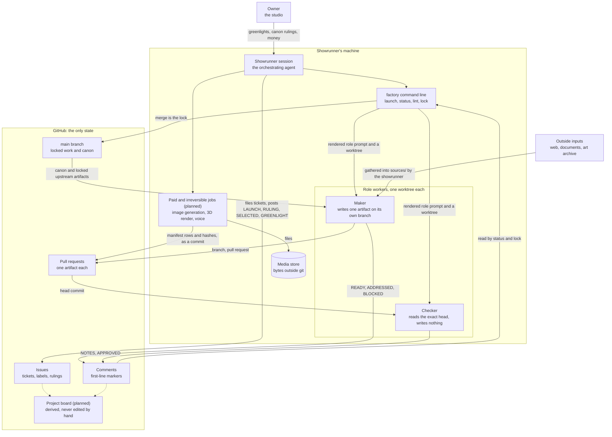
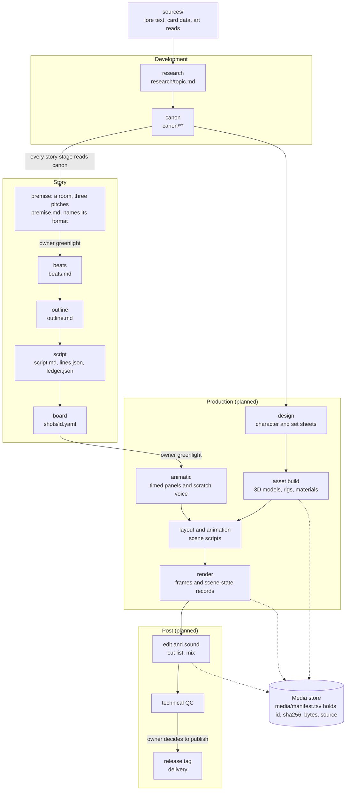
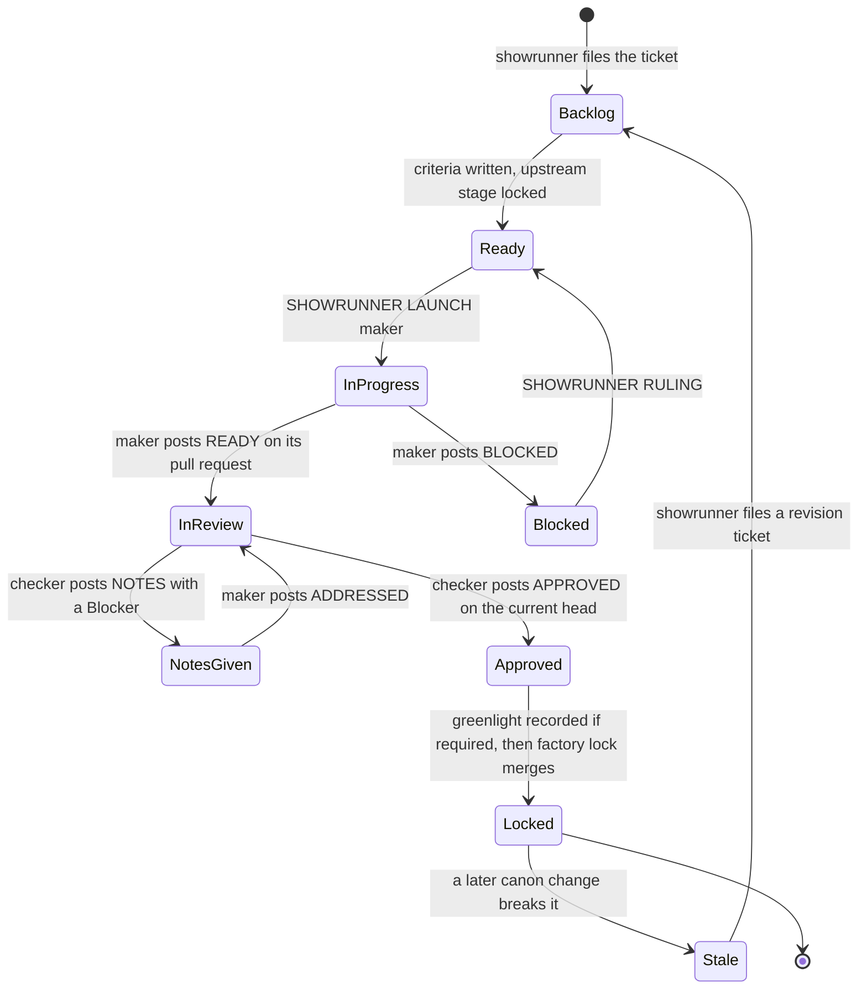
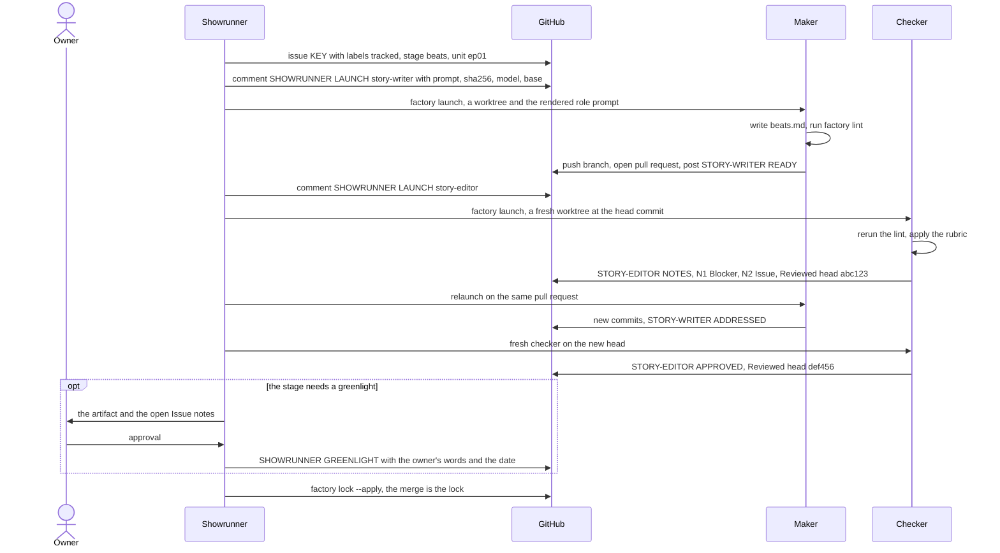
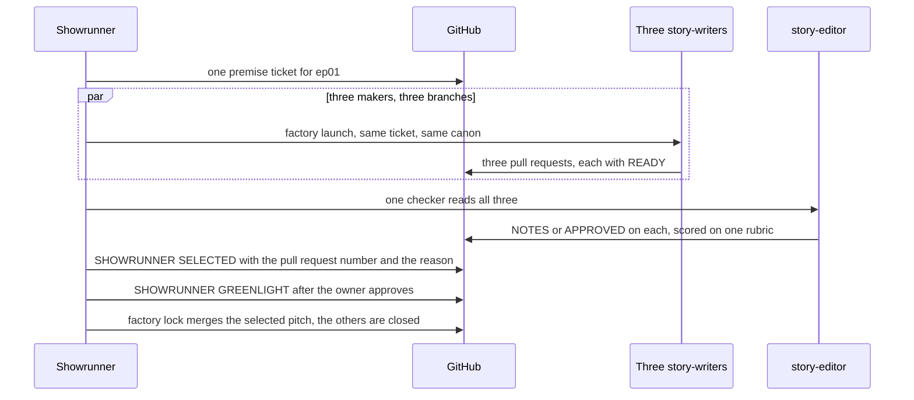
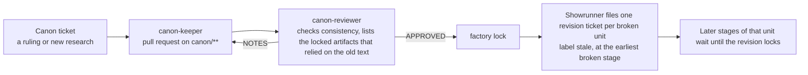

# Architecture

How the content factory is put together: who is responsible for what, how data moves from raw
sources to a finished episode, how GitHub issues and pull requests carry the state, and which tools
each part needs. `system-brief.md` is the specification (file formats, exact gate rules). This file
is the picture. Where they disagree, the brief wins.

Everything marked **planned** is designed here but not in v0. v0 builds the Development and Story
departments: research through storyboard.

## 1. Two layers

This repository is built with the software orchestration kit (`.agents/orchestrator/`: orchestrator,
builder, verifier). What it builds is a second kit, `kit/`, which runs story productions with studio
roles. A production lives in its own repository.

```mermaid
flowchart LR
  subgraph L1["Layer 1: this repository, enrico-factory"]
    ORCH["Orchestrator session"]
    BV["Builder and verifier workers"]
    KIT["kit/<br/>roles, formats, pipeline, factory command line"]
    ORCH -->|"orch launch"| BV
    BV -->|"pull requests, merged by orch merge"| KIT
  end
  subgraph L2["Layer 2: a production repository, one per series"]
    INST[".factory/<br/>the installed kit"]
    SHOW["Showrunner session"]
    ROLES["Role workers<br/>makers and checkers"]
    WORK["sources, research, canon, episodes"]
    SHOW -->|"factory launch"| ROLES
    ROLES -->|"pull requests, locked by factory lock"| WORK
    INST -.->|"prompts, gates"| SHOW
  end
  KIT -->|"factory init"| INST
```

The rest of this file describes layer 2.

## 2. System map

Three facts hold the system together:

1. **GitHub is the only state.** A new session rebuilds the whole picture from issues, pull requests,
   labels and first-line markers. Nothing that matters lives only in chat, memory or local notes.
2. **Makers and checkers never share a worktree and never merge.** They talk only through comments
   on the pull request, and a checker's verdict names the exact commit it read.
3. **Anything that spends money or cannot be undone runs in the showrunner's session**, never in a
   worker.

## 3. Responsibilities

| Who | Studio analog | Decides | Produces | May never |
|---|---|---|---|---|
| **Owner** | studio, network | greenlights, budget, publishing, any canon ruling they choose to make | approvals in their own words | be asked a question the showrunner can settle and undo later |
| **Showrunner** | showrunner, line producer | what gets a ticket, who works it, disputes, which pitch wins a room, when to lock | tickets, `[SHOWRUNNER]` comments, tone notes, the cost ledger (planned), every paid job (planned) | author a maker's artifact, or lock without the gate |
| **Maker** | writer, artist, researcher | how to make its one artifact | a branch, a pull request, `READY` with evidence, `ADDRESSED` per note | merge, write outside its `writes` globs, change canon in a non-canon pull request, spend |
| **Checker** | script coordinator, script supervisor, QC | whether the head commit meets the criteria | `NOTES` (each a `Blocker` or an `Issue`) or `APPROVED`, with `Reviewed head <sha>` | push, edit the pull request, merge, post another role's marker |
| **`factory` command line** | production office | nothing; it applies the rules | worktrees, rendered prompts, status, lint results, the merge | guess: a check that cannot run reports ERROR, not FAIL |

"Checkers never author" is a design choice carried from the software kit. Studios do not work this
way: an animation director corrects by redrawing. Here a correction is the maker relaunched on the
same pull request to address the notes.

### Roles

| Department | Maker | Artifact | Checker | Checks |
|---|---|---|---|---|
| Development | `researcher` | `research/<topic>.md` with an evidence table | `fact-checker` | sampled claims re-derived from the sources |
| Development | `canon-keeper` | `canon/**`: bible, character and place sheets, rulings | `canon-reviewer` | consistency, and which locked work the change breaks |
| Story | `story-writer` | premise pitch, then `beats.md` | `story-editor` | format structure lint, story rubric |
| Story | `script-writer` | `outline.md`, then `script.md`, `lines.json`, `ledger.json` | `story-editor` | format structure lint, story rubric |
| Story | `storyboard-artist` | `shots/<id>.yaml` and the board | `continuity-supervisor` | wardrobe, props, facts, axis and eyeline against canon and the ledger |
| Production (planned) | production designer, character designer, asset builder, layout, animator, lighting and render | design sheets, 3D assets, scene scripts, renders | on-model reviewer, technical checker | scene state read from the engine, renders compared with an approved reference |
| Post (planned) | editor, sound | the cut as code, the mix | technical QC | stream, loudness, spoken lines, cut list |

A role is one file in `kit/roles/`. Adding a department adds files, not code.

## 4. Data flow: the stage ladder

A unit of work (a research topic, a canon change, an episode) climbs ordered stages. A stage must be
locked before the next stage of the same unit may start. The cheap stages come first, so a bad idea
fails on paper, before anything is rendered.

| Stage | Unit | Maker | Checker | Deterministic checks | Judged checks | Owner greenlight |
|---|---|---|---|---|---|---|
| `research` | topic | researcher | fact-checker | provenance tags, cited paths exist | sampled claims re-derived | no |
| `canon` | canon change | canon-keeper | canon-reviewer | provenance, references | consistency, stale list | no |
| `premise` | episode | story-writer, three in a room | story-editor | format named and known | one rubric over every pitch | yes |
| `beats` | episode | story-writer | story-editor | format's beats present in order, durations sum to its runtime | story rubric | no |
| `outline` | episode | script-writer | story-editor | every beat covered by a scene | story rubric | no |
| `script` | episode | script-writer | story-editor | every line in `lines.json`, ledger complete per scene | voice and story rubric | no |
| `board` | episode | storyboard-artist | continuity-supervisor | shot schema, durations, wardrobe and prop ids exist in canon | axis, eyeline, the showrunner's tone notes | yes |
| animatic and later | episode, shot, asset | planned | planned | scene state, stream, loudness, hashes | repeated runs, split votes go to a person | at animatic and at publish |

Short formats skip `outline`; see the formats table in the brief.

**What travels between stages.** Only files on `main`. A maker starts from a worktree of the current
base, so it sees canon and every locked upstream artifact and nothing unfinished. Each factual line
carries a provenance tag (`[text]`, `[art]`, `[inferred]`, `[invented]`), so an invention made at the
premise stage is still visibly an invention at the board stage.

**Media.** Media files are never committed. A job writes the bytes to the media store and commits one
manifest row (id, sha256, size, source) to the pull request. The commit changes the head, so any
verdict given before the job is stale by the ordinary rule. A verdict on a commit is therefore a
verdict on exact bytes.

## 5. How GitHub is used

### Objects

| GitHub object | Means | Written by |
|---|---|---|
| Issue `[KEY] summary`, labels `tracked`, `stage:<stage>`, `unit:<id>` | a ticket: one unit at one stage, with checkable acceptance criteria | showrunner |
| Labels `status:ready`, `status:blocked`, `hold`, `stale` | triage state, a stop on the gate, a unit broken by a canon change | showrunner |
| Issue comment `[SHOWRUNNER] LAUNCH <role> <id>` | the exact prompt a worker was given, its sha256, model and base commit, posted before the worker starts | `factory launch` |
| Issue comment `[SHOWRUNNER] RULING`, `SELECTED #<pr>`, `GREENLIGHT` | a binding decision, the winning pitch, the owner's approval quoted with its date | showrunner |
| Branch and pull request `[KEY] …`, body `Ref #<issue>` | one maker's attempt at one artifact | maker |
| Pull request comment, first line `[<ROLE>] READY` / `ADDRESSED` / `BLOCKED` | the maker's claim, with the head SHA and evidence per criterion | maker |
| Pull request comment, first line `[<ROLE>] NOTES` / `APPROVED` | the checker's verdict on `Reviewed head <sha>` | checker |
| Merge to `main` | the lock | `factory lock --apply` only |
| Tag and release (planned) | delivery of a finished episode | showrunner, after the owner says publish |
| Project board (planned) | a view derived from labels and markers | a sync command, never by hand |

Only the first line of a comment counts as a marker.

### Compared with the orchestration kit

| Orchestration kit (software) | Content factory | Change |
|---|---|---|
| Orchestrator | Showrunner | same authority; also selects in rooms and records greenlights |
| Builder | Maker, one role per craft | roles are data files, not four fixed prompts |
| Verifier | Checker, one per stage | verdict must come from the checker the pipeline names for that stage |
| Fixer | the maker relaunched on the same pull request | no separate role |
| Blast radius | `canon-reviewer` | lists the locked work a canon change breaks |
| `[LIVE-CHECK]`, run and signed by the orchestrator | signed records of showrunner-run media jobs (planned) | same idea: workers cannot produce it |
| Issue `[KEY]` with `tracked` | the same, plus `stage:` and `unit:` | the gate needs to know the unit and stage |
| `[BUILDER] READY` / `ADDRESSED` / `BLOCKED` | `[<ROLE>] READY` / `ADDRESSED` / `BLOCKED` | role id in the marker |
| `[VERIFIER] CHANGES REQUESTED` | `[<ROLE>] NOTES` | each note is a `Blocker` or an `Issue`; only a Blocker stops a lock |
| `[VERIFIER] VERIFIED` | `[<ROLE>] APPROVED` | |
| `[ORCHESTRATOR] LAUNCH` and rulings | `[SHOWRUNNER] LAUNCH`, `RULING`, `SELECTED`, `GREENLIGHT` | two new markers |
| `orch merge --apply`, one merge per run | `factory lock --apply`, one lock per run | adds: upstream stage locked, greenlight recorded, room selection, `writes` globs |
| `merge:hold` | `hold` | |
| `GATES` (build, tests, lint) | `factory lint` (provenance, references, media, structure, roles) | text and data are linted, not compiled |
| Verdict survives a base-only merge | not when the base merge changes canon the work relies on | stricter |
| One task, one pull request | the same, except a room: one ticket, several pull requests, one selected | new |

### A ticket's life

Each state is derived from labels and the newest markers. Nobody sets it by hand. After three rounds
of notes on one pull request the showrunner rules.

### One ticket, start to lock

### A room

The studio writers' room: several writers pitch, one idea is chosen. Used for `premise`.

### A canon change

Canon is the base every story stage builds on, so changing it is the one change that can break work
already locked.

A pull request that touches `canon/**` needs `APPROVED` from `canon-reviewer` whatever its stage, so a
writer cannot change canon inside a script.

## 6. Tools required

### v0

| Who | Tool | For |
|---|---|---|
| Everyone | `git`, GitHub CLI `gh`, Python 3 standard library, bash | the kit has no third-party packages |
| Showrunner | an interactive agent session, a GitHub login with `repo` scope | tickets, rulings, launching, locking |
| Showrunner | `factory` command line | `roles`, `launch`, `status`, `lint`, `lock`, `init` |
| Showrunner | a headless agent command and model access | one worker process per launch; the command is set per machine and is not committed |
| Workers | file read, edit and search; shell limited to `git`, `gh` and `factory lint` | every role |
| `researcher`, `fact-checker` | web search and fetch, image reading | lore, card data and art; the showrunner gathers what workers cannot reach into `sources/` |
| All roles | the production's `rules/production-rules.md`, pasted into every prompt | one source of the hard rules |
| Checkers | a different model from makers, where one is available | a second opinion that does not share the first one's blind spots |

### Planned, by department

These are candidates from the research, not decisions. Each is chosen by an experiment when its
department is built.

| Need | Candidate tools | Run by |
|---|---|---|
| Board panels, design sheets, reference stills | image generation and image editing (xAI Grok Imagine first, other generators as alternates) | showrunner |
| 3D characters and environments | image-to-3D services for a first mesh, Blender for cleanup, rigging and toon shading | showrunner runs paid generation; makers write the build scripts |
| Scenes, animation, render | Blender headless with Python as the pilot; Unreal Engine 5 as a side test on a Windows GPU (`research/04-3d-pipeline.md`, `research/05-ue5.md`) | makers write scene scripts; showrunner runs renders |
| Scene-state checks | per-bone transforms, camera, wardrobe and prop ids read from the engine in a headless run | checker reruns the readout |
| Render-against-reference check | a perceptual difference metric against an approved reference render; the owner's target is within about 10% noticeable difference | checker |
| Animatic, edit | `ffmpeg`, the cut list as code | makers write it; showrunner renders |
| Voice and sound | text-to-speech for scratch and final voice, a loudness meter (`ebur128`) | showrunner |
| Technical QC | `ffprobe` stream checks, black, freeze and silence detection, speech recognition against `lines.json` | checker |
| Judged checks on pictures | a vision model that returns only a defect list in a fixed schema; pass or fail computed in code; several runs with a vote; split votes go to a person | checker |
| Media store | content-addressed storage, a local folder at first | showrunner writes, everyone reads by hash |
| Records of paid jobs | a signed record per job (inputs, tool version, output hashes, cost) that workers cannot forge | showrunner |
| Board, heartbeat | a GitHub Project derived from markers; a timer that dispatches the next step without a model | showrunner's machine |

## 7. Trust boundaries

- **Workers cannot merge.** Only `factory lock --apply` merges, and it rechecks every rule from GitHub
  at that moment.
- **Workers cannot spend.** Generation, rendering and voice run only in the showrunner's session.
- **A maker can write only inside its role's `writes` globs.** The lock refuses a pull request that
  touches anything else.
- **A verdict is bound to a commit.** A new commit, including a manifest row for new media, makes
  every earlier verdict stale.
- **Launch prompts are public record.** The exact prompt, its hash, the model and the base commit are
  posted before a worker starts.
- **Known limit.** Workers run under the showrunner's GitHub login, so the markers are an audit aid
  and stop honest mistakes and drift. They are not proof against a worker that deliberately forges a
  comment. Signed job records (planned) cover the media steps where that matters most.

## 8. Not decided yet

- How a locked artifact pins the canon it relied on: by cited path, or by content hash. The stale list
  is produced by the `canon-reviewer` until this is settled.
- Whether `factory lock` holds a stale unit's later stages itself, or the showrunner does it with the
  `hold` label.
- The 3D toolchain. Blender is the pilot; nothing is chosen.
- The perceptual metric and its threshold for "within about 10% noticeable difference". It has to be
  calibrated on approved references before it gates anything.
- Which stages run on a heartbeat without the showrunner, and when.
