# Architecture

The content factory as diagrams: who is responsible for what, how work moves between rooms, how
GitHub issues and pull requests carry the state, and how the studio improves itself.
`system-brief.md` (v1) is the specification: file formats, the full stage table, exact lock rules.
This file is the picture. Where they disagree, the brief wins. References such as "brief 9" point at
a section of the brief.

In diagrams, markers are written without their square brackets: `LINT PASS` stands for `[LINT] PASS`.

## 1. Two layers

This repository is built with the software orchestration kit (`.agents/orchestrator/`: orchestrator,
builder, verifier). What it builds is a second kit, `kit/`, which runs a show with studio roles. A
show lives in its own production repository.

```mermaid
flowchart LR
  subgraph L1["Layer 1: this repository"]
    ORCH["Orchestrator session"]
    BV["Builder and verifier workers"]
    KIT["kit/<br/>roles, formats, pipeline.json,<br/>lints, evals, factory command line"]
    ORCH -->|"orch launch"| BV
    BV -->|"pull requests, merged by orch merge"| KIT
  end
  subgraph L2["Layer 2: a production repository, one per show"]
    INST[".factory/<br/>the installed kit"]
    RO["Room orchestrators<br/>one per installed room"]
    ROLES["Role workers<br/>makers, checkers, judges,<br/>operators, analysts"]
    WORK["bible, episodes, production, post,<br/>distribution, lab, registries, ledger"]
    RO -->|"factory launch"| ROLES
    ROLES -->|"pull requests, locked by factory lock"| WORK
    INST -.->|"prompts, lint, gate, lock, tick"| RO
  end
  KIT -->|"factory init"| INST
```

The rest of this file describes layer 2.

## 2. System map

Five rooms, each with its own orchestrator. Work moves between rooms only as locked packages. Story
and distribution also exchange two packets as issues.

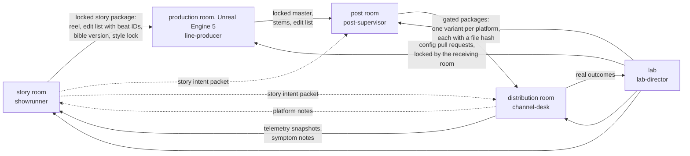

The producer gate, the state and the media sit under every room.

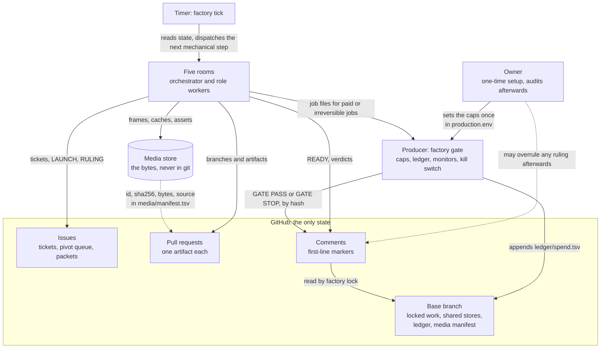

Five facts hold the system together:

1. **GitHub is the only state.** A new session rebuilds the whole picture from issues, pull requests,
   labels and first-line markers.
2. **A handoff needs a lock.** A room hands on only what it has locked, and an orchestrator locks only
   in its own room.
3. **Every stage pairs a deterministic check with a judged review** by an agent that did not make the
   work.
4. **Spending and anything irreversible pass `factory gate`.** No human approves a step inside the
   loop. The owner sets the caps once and may audit and overrule afterwards.
5. **Engagement can propose but never lock.** What the audience does comes back as notes and pivot
   proposals.

## 3. Responsibilities

### Authority

| Who | Does | May never |
|---|---|---|
| Owner | One-time setup: accounts, logins, platform approvals, the caps, the first charter. Audits afterwards and may overrule any ruling | be asked to approve a step inside the loop |
| Producer (`factory gate`, a program) | State machine, budgets, schedule, kill switch, audit log, the gate on spending and on anything irreversible | make a creative call |
| Room orchestrator | Launches workers, rules after three rounds of notes, locks in its own room. `factory tick` files each next ticket from the pipeline when the stage before it locks (an episode stage after a sequence stage, such as `reel` after `board`, once that stage is locked for every sequence of the episode on the base branch); a person files the first ticket of a line of work | build, check, score, or lock in another room |
| Makers | One artifact per ticket on their own branch, built only from locked inputs | lock, merge, touch another ticket's files |
| Lint (`factory lint`) | Deterministic checks: PASS, FAIL or ERROR | make a judgment call |
| Checkers and judges | Judged review by an agent that did not make the work, from another model family where one is available | fix the work, see the maker's reasoning, lock |
| Operators | Run one paid or irreversible job (render, generate, upload) with one credential | run a job without a producer gate PASS on that exact job |

A role is one file in `kit/roles/`. Adding a department adds files, not code. Correction is the maker
relaunched on the same pull request. There is no fixer role.

### Story room

| Role id | Kind | Owns | Checked by |
|---|---|---|---|
| `showrunner` | orchestrator | vision, pivot triage, note triage, locks, drafting amendments | `devils-advocate` challenges |
| `retro-agent` | maker | season retrospectives, proposed changes to role files and rubrics | `held-out-judge` |
| `researcher` | maker | findings with an evidence table, turned into pivot proposals | `fact-checker` |
| `trend-scout` | analyst | shifts in culture and format | |
| `audience-analyst` | analyst | telemetry mapped onto beats, comment clusters, hypothesis results | |
| `render-reviewer` | checker | defects in the released video | |
| `canon-keeper` | maker | the bible: charter, canon ledger, character and place sheets | `canon-reviewer` |
| `story-writer` | maker | premise, beats, treatments | `story-editor` |
| `script-writer` | maker | outline, script, `lines.json`, the episode ledger | `story-editor` |
| `head-of-story` | maker | sequences, assignments, the continuity ledger, merged notes | `continuity-supervisor` |
| `story-artist` | maker | shot lists and panels for one sequence | `continuity-supervisor`, `pitch-judge` |
| `art-director` | maker | model sheets, color script, the style lock | `look-reviewer` |
| `editorial` | maker | timing, scratch voice, temp score, the reel and its edit list | `story-editor` |
| `fact-checker`, `canon-reviewer`, `story-editor`, `continuity-supervisor`, `look-reviewer` | checker | notes on the exact head | |
| `pitch-judge` | judge | blind per-scene preference, old against new | |
| `braintrust` | judge | whole-episode screenings, symptom notes, votes on amendments (seven seats) | |
| `audience-sim` | judge | persona panel: retell test, emotion curve, predicted drop-offs | |
| `distinctiveness-judge` | judge | penalty for work too close to comparable shows or past episodes | |
| `held-out-judge` | judge | a panel the makers have never been tuned against | |
| `devils-advocate` | checker | challenges to the showrunner's note rejections and pivot calls | |

### Production room

| Role id | Kind | Stage | Judged by |
|---|---|---|---|
| `line-producer` | orchestrator | `intake`, and every production lock | |
| `asset-builder` | maker | `assets` | `look-reviewer` |
| `rigger` | maker | `rigging` | `deformation-reviewer` |
| `layout-artist` | maker | `layout` | `cinematography-reviewer` |
| `animator` | maker | `animation` | `performance-reviewer`, blind against the last take |
| `sim-artist` | maker | `simulation` | lint only |
| `lighter` | maker | `lighting` | `look-reviewer` |
| `render-wrangler` | operator | `render` | `dailies-reviewer` |
| `sound-mixer`, `conform-editor` | maker | `conform` | `mix-reviewer` |
| `continuity-supervisor` | checker | `cross-shot` | |

### Post room

| Role id | Kind | Stage | Judged by |
|---|---|---|---|
| `post-supervisor` | orchestrator | every `variant` lock, and the platform rulebook | |
| `platform-editor`, `reframe-artist`, `caption-writer`, `cta-writer`, `thumbnail-artist` | maker | `variant` | `charter-judge`, `packaging-judge` |
| `charter-judge`, `packaging-judge` | checker | `variant` | |

### Distribution room

| Role id | Kind | Stage | Judged by |
|---|---|---|---|
| `channel-desk` | orchestrator | every distribution lock | |
| `channel-youtube`, `channel-tiktok`, `channel-instagram` | operator | `post` | publish check only |
| `telemetry-puller` | operator | `window` | `theory-judge` |
| `theory-judge` | analyst | `window`, judging the pulled telemetry | |
| `community-analyst` | analyst | | |

### Lab

| Role id | Kind | Works on |
|---|---|---|
| `lab-director` | orchestrator | launching the loops, `lab/results.tsv` |
| `method-researcher` | maker | method research |
| `hypothesis-writer` | maker | hypotheses |
| `experimenter` | maker | one change and its measurement, with the metric, tests, judges and threshold frozen |
| `metric-proposer` | maker | metric amendments |

## 4. Data flow: the stage ladders

A unit of work climbs ordered stages. A stage must be locked before the next stage of the same unit
may start. The full table (unit, maker, lint, judge per stage) is brief 6.

**Story: research to reel.**

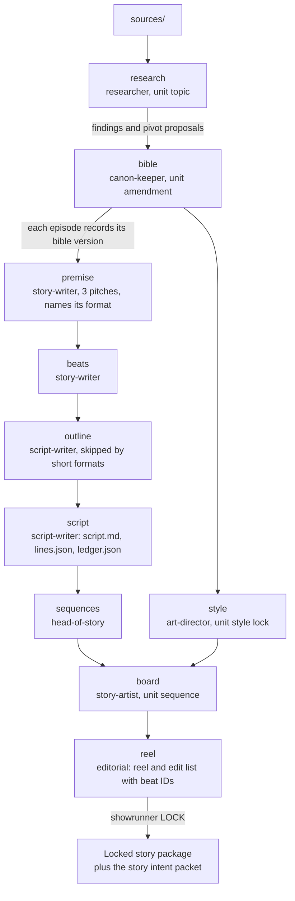

**Production: intake to conform, plus cross-shot.**

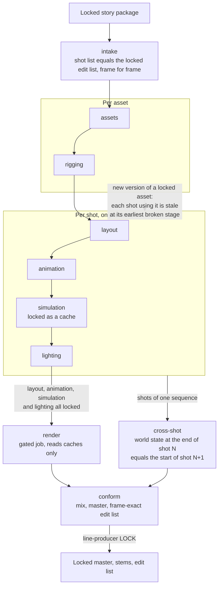

**Post and distribution: variant, then post and window.**

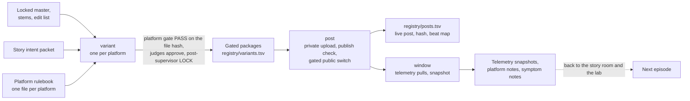

Rules that shape the flow:

- **Cheapest first.** No final render until layout, animation, simulation and lighting are locked on
  previews.
- **Caches, not solvers.** A simulation is locked as a cache. Renders only read caches.
- **Stale assets.** A new version of a locked asset marks every shot that uses it stale at that shot's
  earliest broken stage.
- **Media by hash.** Media bytes go to the media store. The pull request commits one manifest row
  (`id`, `sha256`, `bytes`, `source`). A verdict names the head and the manifest hash, so it is a
  verdict on exact bytes.

## 5. One room in detail

Each room has the same five columns: inputs, governance, makers or operators, checks, outputs. Notes
go back to the room's orchestrator. The labelled dashed edge is the room's feedback path.

### Story room

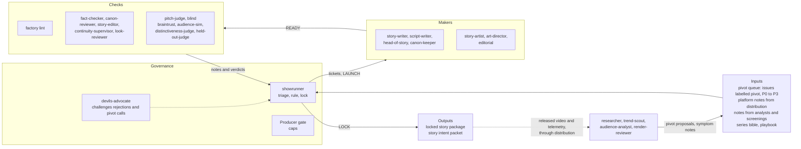

### Production room

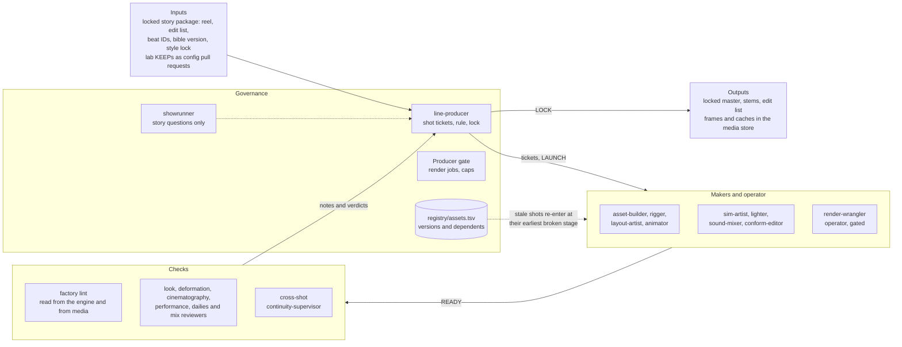

The showrunner answers a production question that would change the story, for example cutting a beat
that costs too much to render. The showrunner never locks a shot. The line producer never changes the
story.

### Post room

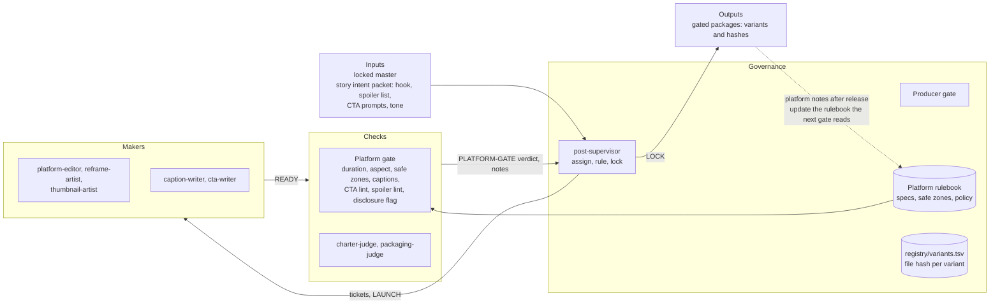

A platform gate verdict names the variant's file hash, so any edit to the file needs new verdicts.

### Distribution room

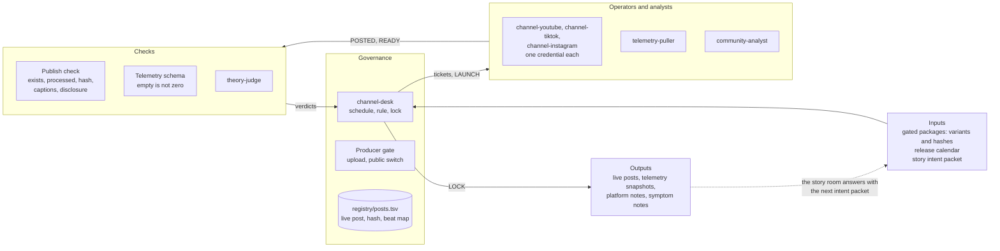

The post registry links every live post to its file hash and beat map. That is how telemetry finds
its way back to story beats.

### Lab

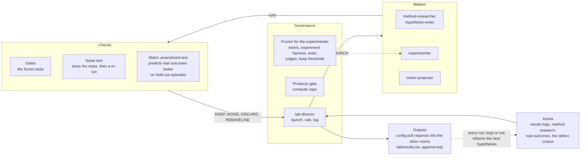

The lab owns the role eval suites in `kit/evals/<role>/`. No role may edit the suite it is measured
by, and a loop never changes its own metric.

## 6. Loops

Each room runs three nested loops. A package leaves a room when the loop that locks it exits; only
the outermost loop changes the room's own rules.

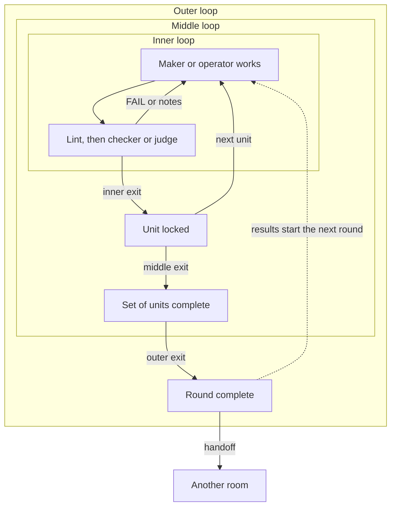

| Room | Inner loop, exit | Middle loop, exit | Outer loop, exit |
|---|---|---|---|
| story | scene (hours): blind win and lint PASS | episode (days): showrunner lock | season (weeks): retro passes its replay tests. Only this loop amends the bible |
| production | shot (hours): fresh PASS and APPROVED on the head | sequence (days): cross-shot diff clean | episode (week): master matches the locked cut |
| post | variant (minutes): PASS on the file hash, judge approval | package (hours): every variant locked | release window (days): producer gate PASS |
| distribution | post (hours): VERIFIED on the live post | window (7 days): snapshot frozen | season: the story room answers the platform notes |
| lab | experiment (minutes): beats the best by twice the noise, twice | program (days): 5 NOISE in a row, or its cap | metric (season): the new metric predicts outcomes better |

### How work moves: `factory tick`

Orchestrators do not poll. A timer runs `factory tick`. It reads GitHub state, dispatches the next
mechanical step, and wakes an orchestrator only for a judgment. The producer's monitors (brief 11)
run on every tick.

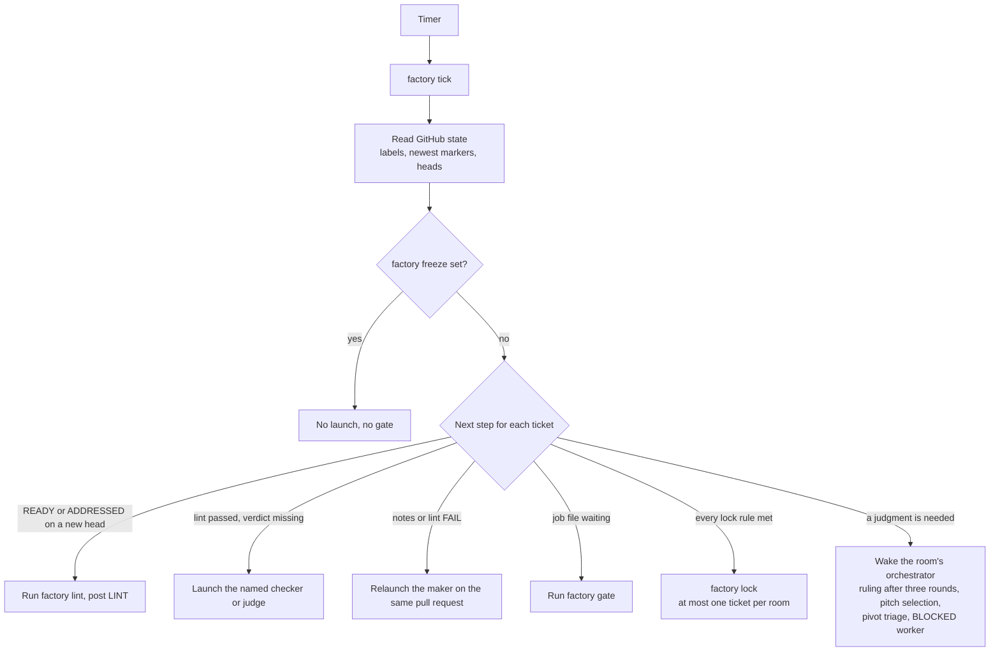

## 7. How GitHub is used

### Objects

| GitHub object | Means | Written by |
|---|---|---|
| Issue `[KEY] summary`, labels `tracked`, `room:<room>`, `stage:<stage>`, `unit:<unit-id>` | a ticket: one unit at one stage in one room | `factory tick`, when the stage before it locks (an episode stage after a sequence stage: once it is locked for every sequence of the episode on the base branch); a person for the first ticket of a line of work |
| Issue labelled `pivot`, class `P0`..`P3` | one entry in the pivot queue: what it touches and a hypothesis written before testing | researcher, trend-scout, audience-analyst |
| Issue: story intent packet | hook, spoiler list, CTA prompts, tone, with every locked episode | story room |
| Issue: platform notes | format limits, CTA results, audience theories, after every release | distribution room |
| Branch and pull request | one artifact. One per ticket, except a pitched stage, where each pitch has its own | maker or operator |
| Comment, first line | a marker (brief 8). Only the first line counts | the role or command the marker names |
| Merge to the base branch | the lock. Refused while the pull request carries `hold` | `factory lock --apply` only |
| Files on the base branch | locked work and the shared stores (brief 7) | by pull request |

A verdict counts only if it ends with `reviewed head <sha> manifest <hash>` naming the current head
and manifest hash, is newer than the maker's last `READY` or `ADDRESSED`, and comes from the role the
pipeline names for that stage. `ERROR` means the check could not run. It is never read as PASS or FAIL.

### A ticket's life

Each state is derived from labels and the newest markers. Nobody sets it by hand. The state names
below are descriptive. The brief fixes the markers, not the names.

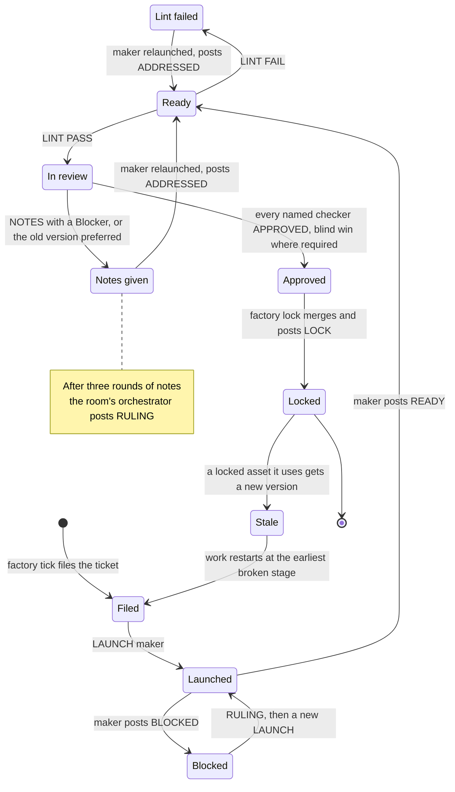

### One ticket, LAUNCH to LOCK

A `beats` ticket in the story room. Every room follows the same steps with its own roles.

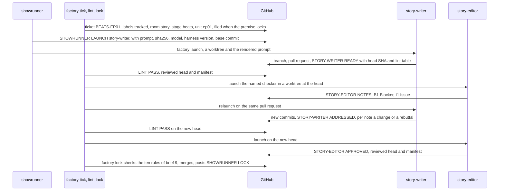

### A pitched ticket

`pitches: N` in the pipeline launches N makers on one ticket. `premise` uses three.

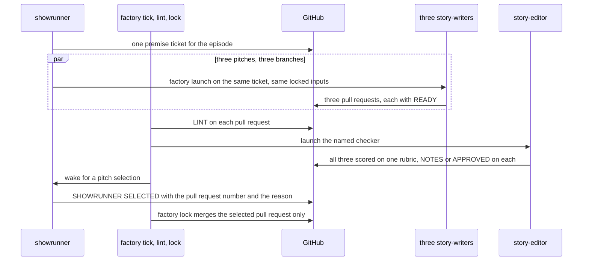

### A bible amendment

The charter and canon change only by amendment. A charter or arc change also needs a Braintrust vote,
and a P2 or P3 pivot needs a supermajority, 5 of 7. The tally below is an invented example.

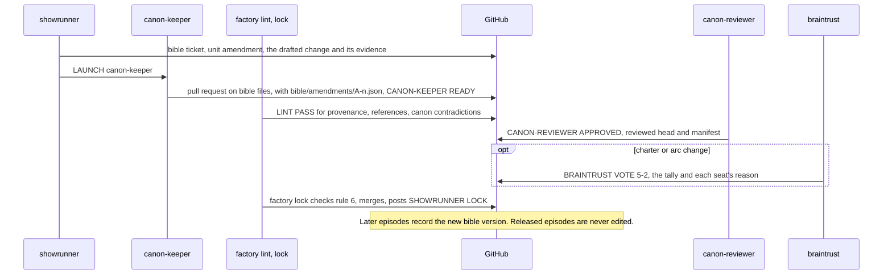

A pull request that touches `bible/**` needs its amendment, the vote its class requires and
`canon-reviewer` `APPROVED`, whatever its stage. A writer cannot change canon inside a script.

### A gated job

`factory gate` is the only path to spending money or doing something that cannot be undone. The
example is a final render.

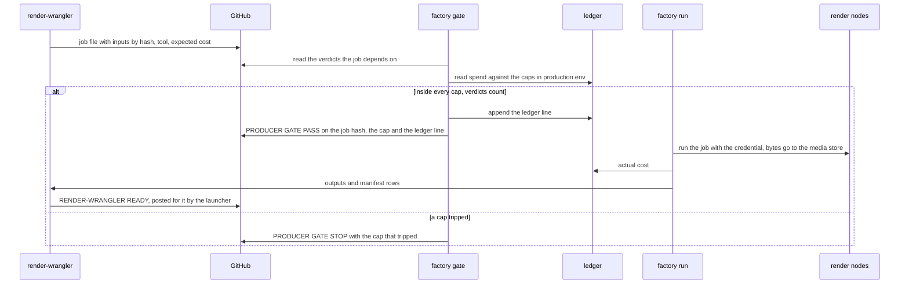

### The staged release

A public post cannot be taken back, so release has three steps. The public switch is its own gated
job. The operator's markers are `[CHANNEL:<PLATFORM>] POSTED` and `VERIFIED`.

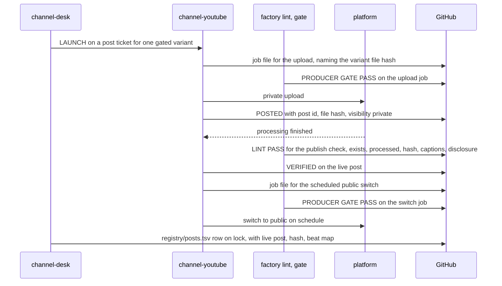

## 8. The lab

Each loop changes one thing, measures one number, keeps the change only if it beats the best result
by more than the noise, and logs every run. The five loops and their metrics are in brief 13.

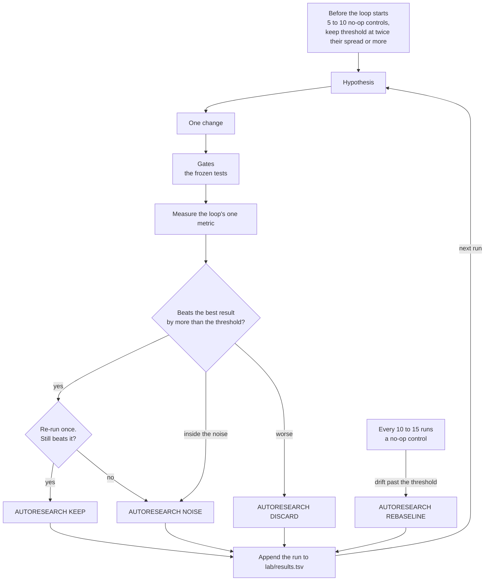

A program stops after 5 NOISE results in a row, or at its cap. Live platform loops only confirm what
offline loops already found.

### How a KEEP reaches a room

The lab never changes a room directly. A winning change is a config pull request that the room's own
orchestrator locks after that room's checks. The example is the render cost loop.

```mermaid
sequenceDiagram
  participant LD as lab-director
  participant EX as experimenter
  participant GH as GitHub
  participant PC as production lint and checkers
  participant LP as line-producer
  LD->>EX: LAUNCH on the render cost loop
  EX->>GH: one change, measured, then re-run once
  LD->>GH: AUTORESEARCH KEEP with metric, runs, noise floor, the results-log line
  EX->>GH: config pull request into the production room
  PC->>GH: LINT PASS and APPROVED on that head
  LP->>GH: factory lock in the production room, LINE-PRODUCER LOCK
  Note over LD,LP: The lab never locks in another room.
```

## 9. Compared with the software orchestration kit

Most parts carry over from the kit that builds this repository. What changes: artifacts are media,
half of every check is a judgment about how something looks or plays, and no person approves.

| Software kit | Content factory | What changed |
|---|---|---|
| Orchestrator, the only role that merges | Room orchestrator: `showrunner`, `line-producer`, `post-supervisor`, `channel-desk`, `lab-director` | five instead of one. Each locks only in its own room |
| Owner decisions, orchestrator-only resources | Producer gate: `factory gate`, a program | caps set once in `production.env`. An operator gets its credential only after `[PRODUCER] GATE PASS` on the exact job |
| Builder | Maker, one role file per craft. Operator for gated jobs | roles are data files. Media is delivered as bytes in the store plus a manifest row |
| Verifier | `factory lint` plus the stage's named checker or judge | deterministic and judged results are separate verdicts. A revision must win blind against the locked version |
| Fixer | the maker relaunched on the same pull request | no separate role |
| Blast radius | the stale-asset rule, and `canon-reviewer` on any change to `bible/**` | a new version of a locked asset marks dependent shots stale at their earliest broken stage |
| CI gates (`GATES`) | `factory lint` | PASS, FAIL or ERROR. ERROR is never read as either |
| Merge gate, `orch merge --apply`, one merge per run | `factory lock --apply`, one pull request per run | adds: upstream stage locked, blind win, pitch selected, amendment and vote, `writes` globs and room, twice-raised notes acted on, producer gate |
| `[BUILDER] READY` / `ADDRESSED` / `BLOCKED` | `[<ROLE>] READY` / `ADDRESSED` / `BLOCKED` | role id in the marker |
| `[VERIFIER] CHANGES REQUESTED` / `VERIFIED` | `[<ROLE>] NOTES` / `APPROVED`, `[LINT]`, `PREFERS A` / `PREFERS B` | a note is a Blocker or an Issue. Only a Blocker stops a lock |
| `[ORCHESTRATOR]` launch records and rulings | `[<ORCHESTRATOR>] LAUNCH`, `RULING`, `SELECTED`, `LOCK` | one per room. `LOCK` is posted by `factory lock` |
| Verdict names the head commit, survives a base-only merge | verdict names the current head and the manifest hash | the hash covers media bytes. Stricter |
| Issue `[KEY]` with `tracked` | the same, plus `room:`, `stage:` and `unit:` | the lock needs the room, unit and stage |
| One task, one pull request | the same, except a pitched stage | one ticket, several pull requests, one selected |
| The orchestrator session drives every step | `factory tick` on a timer | mechanical steps need no model. The orchestrator wakes only for a judgment |

## 10. Runtime

How one role runs, and what it can reach. `harness.md` is the specification; `resources.md` lists
every resource by name, with what exists and what is missing.

```mermaid
flowchart LR
  subgraph PROG["Programs: hold every credential"]
    TICK["factory tick<br/>on a timer"]
    LAUNCH["factory launch<br/>worktree, prompt, LAUNCH marker,<br/>commit, pull request, markers"]
    GATE["factory gate<br/>caps and ledger"]
    RUN["factory run<br/>one gated call"]
    GW["Knowledge gateway<br/>only the role's capabilities,<br/>tagged by production"]
  end
  subgraph BOX["Sandbox: one role, one worktree"]
    H["Agent harness (hbar)<br/>headless, tools from the role file,<br/>no GitHub credential, no keys"]
  end
  subgraph LOGIN["Inference: subscription logins"]
    POOL["Account pool<br/>token on a file descriptor"]
    PROXY["Local proxy<br/>second model family"]
  end
  FERMI["Fermi MCP<br/>skills, memory, search"]
  GH["GitHub<br/>issues, pull requests, markers"]
  subgraph KEYS["Tools: keyed, brokered"]
    GEN["Image, video and voice generation"]
    RENDER["Render nodes<br/>Unreal Engine, headless"]
    STORE["Media store"]
    PLAT["YouTube, TikTok, Instagram"]
  end
  TICK --> LAUNCH
  LAUNCH -->|"starts"| H
  H -->|"result object"| LAUNCH
  LAUNCH --> GH
  POOL -.-> H
  PROXY -.-> H
  H --> GW --> FERMI
  H -->|"job file"| GATE
  GATE -->|"GATE PASS"| RUN
  RUN --> GEN
  RUN --> RENDER
  RUN --> STORE
  RUN --> PLAT
  GATE --> GH
```

| Layer | Rule | Why |
|---|---|---|
| Harness | one, used as a primitive through its public flags | a role's behaviour is changed in its file, tools and knowledge, not in the harness |
| Inference | subscription logins only, passed out of band | no inference key exists to leak, and cost is a known flat amount |
| Tools | reached by key, by a program, after a gate PASS | an agent cannot spend or publish by itself |
| Knowledge | Fermi, through a gateway that exposes capabilities | a memory advises; only a locked file binds |
| State | GitHub, written only by programs | a role cannot post another role's verdict |
| Fork | only when a role's evals fail three lab programs in a row for a cause in the harness | the fork serves that process only and has its own engineering team |

## 11. What is not built

Everything in this file is design. Nothing is built or measured yet. The kit is built in this
repository in the waves of brief 17: text-stage machinery and lints first, then the command line and
the story room, then production tooling, a one-shot pilot, a full episode, and the live loops last.
